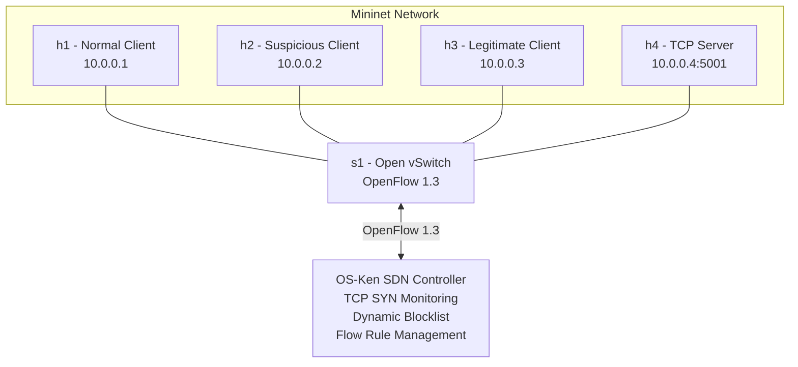

# Dynamic Host Blocking System using SDN

**Computer Networks Mini-Project — Project 12**

## 1. Project Overview

### Problem Statement

Develop a system that identifies abnormal TCP traffic patterns and dynamically blocks suspicious hosts using Software Defined Networking (SDN) flow rules.

### Objective

The objective is to monitor TCP connection attempts, identify hosts generating abnormal traffic, and dynamically block suspicious hosts through OpenFlow rules while maintaining connectivity for legitimate hosts.

The system uses:
- TCP socket programming.
- Mininet for network emulation.
- Open vSwitch (OVS) as the SDN switch.
- OS-Ken as the SDN controller.
- OpenFlow 1.3 for dynamic flow-rule management.
- Python threading for concurrent TCP server connections.

## 2. System Architecture

### Network Topology

The project uses four Mininet hosts connected to one Open vSwitch.

| Component | IP Address | Role |
|---|---|---|
| h1 | 10.0.0.1 | Normal TCP client |
| h2 | 10.0.0.2 | Suspicious / attacker client |
| h3 | 10.0.0.3 | Legitimate concurrent client |
| h4 | 10.0.0.4 | Protected TCP server |
| s1 | OpenFlow switch | Network traffic forwarding |

The SDN controller communicates with switch s1 through OpenFlow 1.3 on TCP port 6653.

### Architecture Diagram



### Traffic Detection Workflow

1. Normal and suspicious hosts send TCP connection requests to h4.
2. The controller monitors TCP SYN packets using a sliding time window.
3. Each source IP address has its own SYN request history.
4. If a host sends at least 8 SYN packets within 5 seconds, it is identified as suspicious.
5. The controller adds the source IP to its dynamic blocklist.
6. An OpenFlow DROP rule with priority 200 is installed on the switch.
7. The suspicious host's traffic is blocked.
8. Legitimate hosts below the threshold continue communicating.
9. After the 25-second cooldown expires, the controller removes the DROP rule and restores connectivity.

## 3. Detection Configuration

The controller uses the following parameters:

| Parameter | Value | Description |
|---|---:|---|
| Monitoring window | 5 seconds | Sliding observation window |
| SYN threshold | 8 | Maximum tolerated SYN count before blocking |
| Blocking duration | 25 seconds | Cooldown period |
| Statistics interval | 4 seconds | OpenFlow statistics polling interval |
| Monitoring rule priority | 100 | TCP SYN monitoring |
| Blocking rule priority | 200 | Suspicious host blocking |

### OpenFlow Blocking Rule

The controller installs a rule matching the suspicious source IP address.

Example:

```text
priority=200,
ip,
nw_src=10.0.0.2,
actions=drop
```

The blocking rule has a higher priority than the ordinary forwarding rules.

An empty action list causes matching packets to be discarded by the switch.

## 4. Project File Structure

```text
CN clg project/
│
├── controller.py
│   └── OS-Ken SDN controller
│
├── topology.py
│   └── Four-host Mininet topology
│
├── server.py
│   └── Concurrent TCP socket server
│
├── traffic_generator.py
│   └── TCP traffic generation and performance measurement
│
├── run_demo.py
│   └── Automated project demonstration
│
├── performance_test.py
│   └── Baseline and dynamic SDN comparison
│
├── requirements.txt
│   └── Python dependencies
│
├── performance_results.csv
│   └── Combined experiment results
│
├── baseline_h1.csv
├── baseline_attack.csv
├── baseline_legitimate.csv
├── dynamic_h1.csv
├── dynamic_attack.csv
├── dynamic_legitimate.csv
├── dynamic_recovery.csv
│   └── Individual performance measurement results
│
├── controller.log
│   └── Live demonstration controller logs
│
├── controller_performance.log
│   └── Performance experiment controller logs
│
└── README.md
    └── Project documentation
```

## 5. Software and Environment Requirements

The project was tested in the following environment:

| Component | Tested Version / Configuration |
|---|---|
| Operating system | Ubuntu through WSL2 |
| Python | 3.14.4 |
| Mininet | Installed |
| Open vSwitch | Installed |
| OS-Ken | 3.1.1 |
| Eventlet | 0.40.4 |
| OpenFlow | 1.3 |

Required components:
- Ubuntu Linux
- Python 3
- Mininet
- Open vSwitch
- OS-Ken SDN controller
- Eventlet
- Python socket and threading libraries

The Python controller dependencies are listed in `requirements.txt`.

## 6. How to Run the Project

### Step 1 — Open Ubuntu

Open the Ubuntu terminal in WSL2 and navigate to the extracted project directory.

```bash
cd "/path/to/CN clg project"
```

Replace the example path with the actual project folder location.

### Step 2 — Clean Mininet

```bash
sudo mn -c
```

### Step 3 — Run the Automated Demonstration

```bash
sudo python3 run_demo.py
```

The automated demonstration performs the following operations:

1. Starts the OS-Ken SDN controller.
2. Creates the four-host Mininet topology.
3. Checks network connectivity using pingall.
4. Starts the TCP server on h4, port 5001.
5. Generates normal TCP traffic from h1.
6. Generates abnormal TCP traffic from h2.
7. Demonstrates dynamic host blocking.
8. Tests legitimate communication from h3.
9. Displays the OpenFlow flow table.
10. Waits for the blocking cooldown to expire.
11. Verifies that h2 can communicate again.

### Step 4 — Inspect Controller Logs

```bash
grep -E '\[ALERT\]|\[BLOCKLIST\]|\[SDN DROP RULE\]|\[UNBLOCK\]|\[RECOVERY\]' controller.log
```

### Step 5 — Clean Up Mininet

```bash
sudo mn -c
```

## 7. Performance Evaluation

The project compares two network configurations.

### Experiment A — Static OVS Baseline

A four-host Mininet network uses static OVS forwarding without the dynamic host-blocking controller.

The experiment measures:
- Normal TCP traffic.
- Abnormal traffic from h2.
- Legitimate traffic from h3.
- Connection success and failure rates.
- TCP request-response latency.

### Experiment B — Dynamic SDN System

The same topology is tested using the OS-Ken controller and dynamic OpenFlow blocking.

The controller detects abnormal SYN traffic, installs DROP rules and automatically restores connectivity after the cooldown period.

### Running Performance Experiments

Execute:

```bash
sudo python3 performance_test.py
```

The script automatically:
1. Runs the static OVS baseline.
2. Runs the dynamic SDN experiment.
3. Generates traffic from multiple hosts.
4. Tests h2 and h3 simultaneously.
5. Checks the active OpenFlow DROP rule.
6. Verifies automatic recovery.
7. Exports individual CSV measurements.
8. Generates a combined `performance_results.csv` file.

### Experimental Results

The following results were recorded during the corrected performance experiment.

| Metric | Static OVS | Dynamic SDN |
|---|---:|---:|
| h1 successful connections | 3/3 | 3/3 |
| h1 success rate | 100% | 100% |
| h2 attack attempts | 120 | 22 |
| h2 successful connections | 120 | 7 |
| h2 success rate | 100% | 31.82% |
| h2 timeouts | 0 | 15 |
| h3 legitimate connections | 6/6 | 6/6 |
| h3 success rate | 100% | 100% |

### Latency Measurements

Average TCP request-response latency recorded by the traffic generator:

| Traffic | Static OVS | Dynamic SDN |
|---|---:|---:|
| h1 normal traffic | 0.94 ms | 3.92 ms |
| h2 successful attack connections | 0.83 ms | 4.27 ms |
| h3 legitimate traffic | 1.21 ms | 4.30 ms |
| h2 after recovery | Not applicable | 4.25 ms |

### Additional Observations

- The first failed h2 connection occurred approximately 0.75 seconds after attack traffic started.
- The controller detected the threshold of 8 SYN packets within 5 seconds.
- The switch installed a priority-200 DROP rule for 10.0.0.2.
- The OpenFlow DROP rule recorded 48 matching packets during the observed statistics snapshot.
- No DROP rule was installed for legitimate host h3 in the corrected experiment.
- h3 maintained 100% successful connections.
- h2 successfully reconnected after automatic recovery.

### Performance Evaluation Limitations

These measurements represent one experimental run per condition, not averaged results across repeated trials.

The traffic generator uses a connection timeout of 0.4 seconds. Blocked connection attempts therefore take longer to complete, causing fewer total attempts during the dynamic-blocking experiment.

Consequently, the total attempt counts between the baseline and dynamic experiments should not be interpreted as identical offered traffic loads.

Latency values represent successful TCP request-response measurements and are specific to the tested WSL/Mininet environment.

## 8. Test Cases

| Test Case | Expected Result | Observed Result |
|---|---|---|
| Initial network connectivity | All hosts reachable | Passed |
| Normal traffic from h1 | Connections allowed | Passed |
| Abnormal traffic from h2 | Suspicious host detected | Passed |
| Dynamic DROP rule installation | Host traffic blocked | Passed |
| Legitimate traffic from h3 | Connections allowed | Passed |
| Flow statistics collection | Packet and byte counters displayed | Passed |
| Automatic recovery | DROP rule removed | Passed |
| h2 after recovery | Connections restored | Passed |

## 9. Key Viva Questions and Answers

**1. What is the main objective of this project?**

To identify abnormal TCP connection patterns and dynamically block suspicious hosts using SDN and OpenFlow flow rules.

**2. What is SDN?**

Software Defined Networking separates the control plane from the data plane. The controller makes network decisions, while switches forward packets according to installed rules.

**3. What is Mininet?**

Mininet is a network emulator used to create virtual hosts, switches and links on a single machine.

**4. What is OpenFlow?**

OpenFlow is a protocol that allows an SDN controller to communicate with programmable switches and manage their flow tables.

**5. What is OS-Ken?**

OS-Ken is a Python-based SDN controller framework used to build network control applications.

**6. What is a TCP SYN packet?**

SYN is a TCP control flag used to initiate a TCP connection. It is the first step in the TCP three-way handshake.

**7. What is a sliding window?**

A sliding window maintains recent observations within a fixed time interval. Older timestamps are removed as the window advances.

**8. How does the controller detect suspicious traffic?**

It tracks TCP SYN packets separately for each source IP. If a host reaches 8 SYN packets within 5 seconds, it is considered suspicious.

**9. How does the system block a suspicious host?**

The controller installs an OpenFlow DROP rule with priority 200 matching the suspicious source IP address.

**10. Why is the DROP rule priority 200?**

It gives the blocking rule higher priority than ordinary forwarding rules, which use priority 10.

**11. What is a dynamic blocklist?**

It is a collection of suspicious source IP addresses and their blocking expiration timestamps.

**12. How does automatic recovery work?**

The controller checks the blocklist periodically. Once the cooldown expires, it removes the corresponding DROP rule using an OpenFlow flow deletion message.

**13. Why do we use TCP sockets?**

TCP sockets allow reliable, connection-oriented communication between clients and servers.

**14. How does the server support multiple clients?**

The server creates a separate Python thread for each accepted client connection.

**15. What are OpenFlow flow statistics?**

They provide information such as packet count, byte count and flow duration for installed switch rules.

**16. Why is h3 important in this project?**

h3 demonstrates that legitimate users can continue communicating while a suspicious host is blocked, provided their traffic remains below the configured detection threshold.

**17. What happens after the cooldown period?**

The DROP rule is removed, the host is removed from the dynamic blocklist, and its traffic can resume.

## 10. Conclusion

The Dynamic Host Blocking System demonstrates the integration of TCP socket programming with Software Defined Networking.

The implementation monitors TCP SYN traffic, detects suspicious connection rates, dynamically installs OpenFlow DROP rules, collects switch statistics and automatically restores connectivity after a cooldown period.

The Mininet experiments demonstrate that abnormal traffic can be blocked while legitimate traffic from another host continues to reach the TCP server.

The project successfully demonstrates TCP communication, concurrency, SDN control, socket-SDN integration, dynamic flow-rule management and performance comparison against static OVS forwarding.

---

**Project:** Dynamic Host Blocking System  
**Course:** Computer Networks  
**Environment:** Ubuntu / WSL2, Mininet, Open vSwitch and OS-Ken  
**Protocol:** TCP / OpenFlow 1.3
